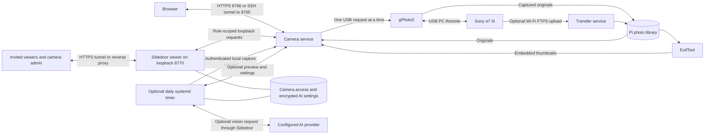

# Sony Pi Camera

[](https://github.com/affromero/sony-pi-camera/actions/workflows/checks.yml)
[](https://github.com/affromero/sony-pi-camera/actions/workflows/codeql.yml)
[](https://github.com/affromero/sony-pi-camera/actions/workflows/dead-code.yml)
[](https://github.com/affromero/sony-pi-camera/actions/workflows/gitleaks.yml)
[](.github/dependabot.yml)
[](#connect-the-camera)

Control a USB-connected Sony α7 III from a browser on your local network. A Raspberry Pi serves the live preview, camera controls and photo gallery. This setup has been tested with an α7 III running firmware 4.04, a Sigma 35mm F1.2 DG DN Art and a Raspberry Pi Zero 2 W.

## Why this exists

A camera mounted out of reach can be awkward to operate from its rear screen. A Pi beside the camera keeps the USB connection open so a photographer on the same Wi-Fi can check focus, trigger the shutter and review original files from a browser.

## Connect the camera

Power the Pi separately. Connect the camera to the Pi's USB data port using a data cable and, on a Zero, an OTG adapter. Set the camera's USB Connection to **PC Remote**. On the Pi, sign in as the account that will operate the camera and run the following commands.

```sh
sudo apt update
sudo apt install git gphoto2 libimage-exiftool-perl openssl python3-pil
git clone https://github.com/affromero/sony-pi-camera.git
cd sony-pi-camera
gphoto2 --auto-detect
gphoto2 --summary
sudo sh camera/install.sh
```

The installer starts a systemd service under your account. To view its status or troubleshoot a busy USB device, use these commands. Close other software holding the camera before restarting the service.

```sh
systemctl status "sony-pi-camera@$USER"
journalctl -u "sony-pi-camera@$USER" -n 30
```

## Open the dashboard

**On the Mac**, use Terminal to clone a second copy of the project. Replace `user@hostname.local` with the Pi account and hostname you configured. The first SSH command should print the Pi's hostname using your SSH key.

```sh
git clone https://github.com/affromero/sony-pi-camera.git
cd sony-pi-camera
ssh -o BatchMode=yes user@hostname.local hostname
sh camera/open-camera.sh user@hostname.local
```

The helper opens the authenticated dashboard in your browser. With the camera on and connected in PC Remote mode, look for **Connected** and a live image. You can reopen `http://localhost:8765/` in the same browser tab while the tunnel is running.

On a phone or another device on the same LAN, use `https://hostname.local:8766/` with your Pi's actual hostname. Retrieve the public certificate and access key over SSH. Compare the downloaded certificate's SHA-256 fingerprint with the Pi's output before trusting it on your device. Enter the access key on the dashboard. Keep the service on your local network.

```sh
ssh user@hostname.local 'openssl x509 -in ~/.config/sony-pi-camera/camera.crt -noout -fingerprint -sha256'
scp user@hostname.local:.config/sony-pi-camera/camera.crt ./camera.crt
openssl x509 -in camera.crt -noout -fingerprint -sha256
ssh user@hostname.local 'cat ~/.config/sony-pi-camera/camera-token'
```

On iPhone or iPad, transfer the verified public certificate to the device and install its profile. In **Settings → General → About → Certificate Trust Settings**, enable trust for that certificate, then open the Pi's HTTPS address in Safari. [Apple’s certificate trust instructions](https://support.apple.com/en-us/102390)

## Shooting and reviewing photos

The live view requests one JPEG at a time over USB. When you focus, change a setting, move the magnifier or take a photo, the dashboard holds the last frame and pauses the camera controls. Live view resumes when the operation finishes. Another browser attempting a camera command at the same time receives a busy message.

- Set the lens to AF and the camera's focus area to Flexible Spot. Tap the live preview to move the focus point and autofocus. A green marker indicates the body reported a lock.
- Choose **Select area to magnify** below the live preview, then drag a box around the detail you want to inspect. On a phone you can also tap its center. The camera uses its supported magnification steps. The orange outline on the overview shows the area it actually displays. Choose **Full frame** to select another area or tap to focus.
- The dashboard polls the battery level, shooting mode and settings. APS-C crop is adjustable on the body and displayed in the browser. Aperture choices currently assume the tested Sigma lens.
- Press the shutter in a magnified view to save that framing as a JPEG in the Pi gallery. The Pi crops the camera's full-resolution JPEG at its native pixel size, so a tighter crop has fewer pixels. Choose a JPEG or RAW + JPEG capture setting for framed shots. At **Full frame**, the shutter downloads the camera files directly.
- Existing SD card folders are unavailable over this body's PC Remote connection. The gallery also picks up photos transferred into the same directory.

## Share the live camera

The optional Sidedoor viewer has its own hostname and access rules. Use the admin password to view and download photos, change camera settings, delete Pi copies, configure AI advice, and issue viewer invitations. Each invitation works once within 24 hours. The viewer can see the live preview and download the entire Pi gallery, including future captures and uploads. A viewer session lasts 30 days on the browser that accepted it. Use **Show active viewers** to revoke one early. The private Pi dashboard and other projects keep their own access.

Install Node.js 22 or newer on the Pi, with `node` on systemd's PATH. Debian's `build-essential` and `python3` supply the native build tools needed by Sidedoor. Run the camera installer, then install the pinned dependencies and create the admin in a Bash shell on the Pi. Use a strong, unique password.

```sh
sudo npm ci --prefix /opt/pi-camera/sidedoor
viewer_state="/var/lib/sony-pi-camera-$USER"
sudo install -d -m 700 -o "$USER" "$viewer_state"
read -r -s -p 'Camera admin password: ' viewer_password
printf '\n'
printf '%s\n' "$viewer_password" | STATE_DIRECTORY="$viewer_state" \
  node /opt/pi-camera/sidedoor/web/server.mjs setup
unset viewer_password
```

Replace `camera.example.com` with the viewer's HTTPS hostname.

```sh
printf '%s\n' 'VIEWER_ORIGIN=https://camera.example.com' | \
  sudo tee "/etc/sony-pi-viewer-$USER.conf" >/dev/null
sudo chmod 600 "/etc/sony-pi-viewer-$USER.conf"
sudo systemctl enable --now "sony-pi-viewer@$USER.service"
```

Publish that hostname with an HTTPS reverse proxy or a Cloudflare Tunnel pointing to `http://127.0.0.1:8770` on the Pi. Preserve the public `Host` header and bypass proxy caching for the viewer hostname. Keep the camera API on port 8765 and the Pi dashboard off the public route. Check the viewer service with `systemctl status "sony-pi-viewer@$USER.service"`. [Cloudflare published applications](https://developers.cloudflare.com/cloudflare-one/networks/connectors/cloudflare-tunnel/routing-to-tunnel/)

Open the public URL as admin, expand **Viewer invitations**, and create a link. Send the link privately to the recipient. A second recipient needs a new link.

## Daily photos

The installer provides an optional systemd timer. It starts disabled and defaults to 08:00 in the Pi's timezone. Leave the camera powered on in PC Remote mode. Each run saves a photo in the dashboard gallery using the camera's current settings and framing, including any active magnifier crop.

To choose a time, run `sudo systemctl edit "sony-pi-capture@$USER.timer"` on the Pi. For example, to shoot at 08:00 Chicago time, enter the following override. The empty line after the first equals sign clears the default schedule. Add more `OnCalendar` entries for additional shots each day.

```ini
[Timer]
OnCalendar=
OnCalendar=*-*-* 08:00:00 America/Chicago
```

Enable the timer and check its next run:

```sh
sudo systemctl enable --now "sony-pi-capture@$USER.timer"
systemctl list-timers --all "sony-pi-capture@$USER.timer"
```

The timer skips missed times while the Pi is off. If another camera command is running, the job waits up to one minute for its turn. To take one photo immediately, run `sudo systemctl start "sony-pi-capture@$USER.service"`. Check filenames or errors with `journalctl -u "sony-pi-capture@$USER.service" -n 10`. To stop future shots, run `sudo systemctl disable --now "sony-pi-capture@$USER.timer"`.

### Optional AI advice before capture

The timer can send one JPEG preview and the camera's current exposure and white balance settings to a vision model through Sidedoor. Give it a goal such as “Keep moving subjects sharp and lift dark shadows.” The job logs an assessment and any suggested values the camera reports as writable. Suggestions appear in the systemd journal, and the shutter uses the camera's current settings. Camera controls are available again while the model runs, so a manual change can affect the subsequent shot.

Sign in as admin and open **AI advice for scheduled captures**. Choose an API provider, enter a vision model with structured output, add its API key and describe the photo you want. Select **Analyze a preview before each scheduled shot** and save. Sidedoor encrypts the API key on the Pi. A blank key field keeps the selected provider's saved credential. **Check saved API key** contacts that provider without sending a camera preview.

With AI enabled, a preview or provider error fails the run before the shutter fires. Clear the checkbox and save to resume ordinary scheduled captures. The schedule stays in the timer override above. Starting the service manually requests advice and takes a real photo when the advice succeeds.

## Optional camera uploads over Wi-Fi

The optional explicit FTPS receiver accepts the configured camera's IPv4 address and writes uploads to the gallery. It permits legacy TLS for older Sony firmware. Use it only on a trusted LAN. Reserve the Pi and camera addresses in DHCP.

Install the receiver dependencies and replace `CAMERA_IPV4` below with the camera's address.

```sh
sudo apt install python3-pyftpdlib python3-openssl
printf '%s\n' CAMERA_IPV4 > ~/.config/sony-pi-camera/transfer-camera-ip
sudo systemctl enable --now "pi-camera-transfer@$USER"
```

Copy the Pi's public `~/.config/sony-pi-camera/transfer-ca.crt` to an SD card as `cacert.pem`. Use slot 1 and select **Network → Import Root Certificate** on the Sony. For the FTP destination, enter the Pi's IPv4 address, port 2121, user `camera`, and the password stored on the Pi in `~/.config/sony-pi-camera/transfer-password`. Enable Secure Protocol, passive transfer and certificate verification. Allow inbound TCP 2121 and 30000 through 30010 from the camera if a LAN firewall is active. Concurrent FTP and USB remote operation depends on camera configuration.

## Architecture



The Pi can serve its library while the camera is disconnected. Capturing and live preview require the USB connection. See the [camera glossary](GLOSSARY.md) for the names used in the interface.

## Development

Use uv, Node.js and ShellCheck. On macOS, install them with `brew install uv node shellcheck`. On Debian, install `nodejs` and `shellcheck` with apt and install uv using its [installation guide](https://docs.astral.sh/uv/getting-started/installation/). From the checkout, create a development environment and run the checks.

```sh
uv sync --frozen --python 3.13
uv run --frozen pre-commit install --install-hooks
uv run --frozen pre-commit run --all-files
uv run --frozen python -m unittest discover -s tests -v
node --check camera/camera.js
(cd camera/sidedoor && npm ci && npm test)
```

The dashboard uses Pillow for cropped JPEGs. Camera operations and thumbnails also need the system commands `gphoto2` and `exiftool`. The Pi installer runs services under the OS Python. For local receiver development, `uv sync --frozen --extra ftps` installs pyftpdlib and pyOpenSSL. Update dependencies in `pyproject.toml`, run `uv lock` and commit the updated lockfile.

The tests start the HTTP service on loopback, use a temporary photo library and simulate the USB device. CI checks the lockfile, imports the optional FTPS receiver and runs the tests on Python 3.11 and 3.13. Test changes to capture, focus or magnification on a connected body before reporting hardware support.

The archived Windows utility SonyAlphaUSB provided a reference for the α7 III focus-point coordinates. [gPhoto2](https://github.com/gphoto/gphoto2) · [SonyAlphaUSB](https://github.com/pixeltris/SonyAlphaUSB)

## License

[MIT License](LICENSE) © 2026 Andrés Romero.
