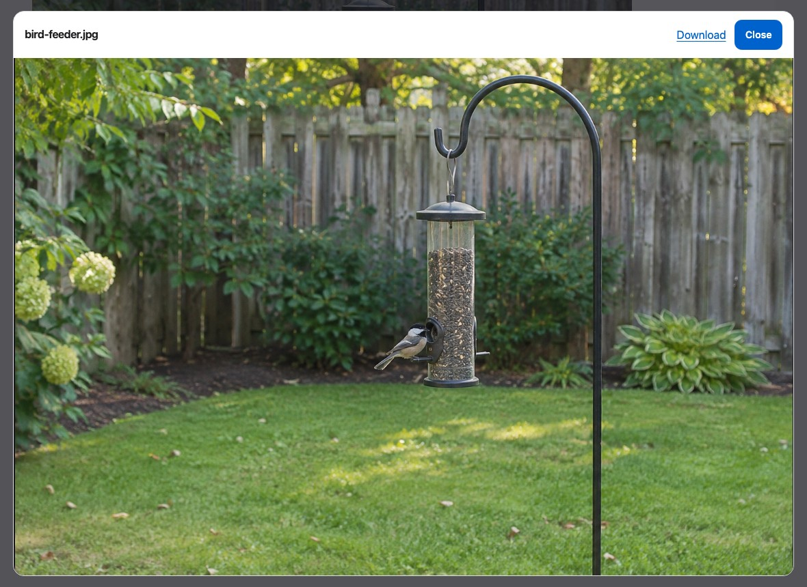
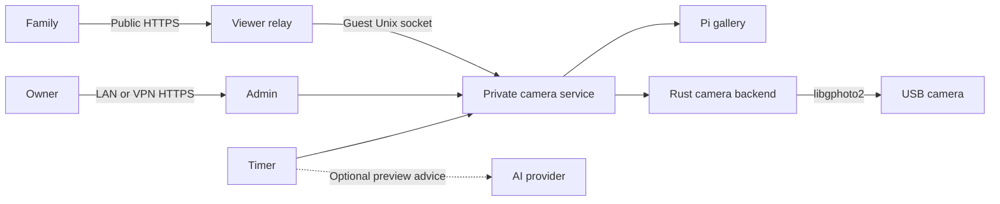

# Sony Pi Camera

Preview, control, and schedule photos from a USB-connected Sony camera on a Raspberry Pi. A family password or invitation opens a read-only gallery with live preview and original downloads. Optional AI advice suggests settings before a scheduled shot.

The admin takes a photo from the live preview. It appears below under **Photos on the Pi**.

Family members can open that same photo in their read-only viewer and download the original.

Example setup for watching a backyard bird feeder and sharing photos with family. The scene and settings are simulated.

## Why use this?

Keep the lens and image quality of a dedicated camera while a Raspberry Pi handles capture, storage, and remote access.

- **Make a timelapse.** Schedule photos of a growing plant, a backyard feeder, or a workshop project. Assemble the saved frames into a video.
- **Get AI advice before a shot.** Ask a vision model to inspect a preview and suggest settings for a goal like keeping birds sharp in changing light. [Set up AI advice](SETUP.md#optional-ai-advice-before-capture)
- **Build a computer vision pipeline.** Feed saved images from the Pi to your own script. Use an object detector to count birds at a feeder, or track how a seedling grows across a series of photos.

## Architecture

The Raspberry Pi controls the Sony camera over USB and stores the photos locally. The owner uses the browser dashboard to adjust settings or take a photo. Family viewers reach the live preview and gallery through a read-only HTTPS relay.

Scheduled captures run on the Pi. When AI advice is enabled, the timer can send a preview to a vision model before taking the photo.

[Setup and operation](SETUP.md) · [USB benchmarks](SETUP.md#compare-usb-preview-backends) · [Changelog](CHANGELOG.md) · [Glossary](GLOSSARY.md) · [MIT license](LICENSE)
