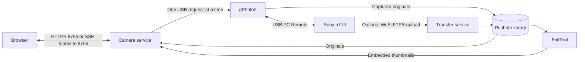

# Sony Pi Camera

[](https://github.com/affromero/sony-pi-camera/actions/workflows/checks.yml)
[](#connect-the-camera)

Control a USB-connected Sony α7 III from a browser on your local network. A Raspberry Pi serves the live preview, camera controls and photo gallery. This setup has been tested with an α7 III running firmware 4.04, a Sigma 35mm F1.2 DG DN Art and a Raspberry Pi Zero 2 W.

## Connect the camera

Power the Pi separately. Connect the camera to the Pi's USB data port using a data cable and, on a Zero, an OTG adapter. Set the camera's USB Connection to **PC Remote**. On the Pi, sign in as the account that will operate the camera and run the following commands.

```sh
sudo apt update
sudo apt install git gphoto2 libimage-exiftool-perl openssl
git clone https://github.com/affromero/sony-pi-camera.git
cd sony-pi-camera
gphoto2 --auto-detect
gphoto2 --summary
sudo sh camera/install.sh
```

The installer starts a systemd service under your account. To view its status or troubleshoot a busy USB device, use these commands. Close other software holding the camera before restarting the service.

```sh
systemctl status "pi-field-notes-camera@$USER"
journalctl -u "pi-field-notes-camera@$USER" -n 30
```

## Open the dashboard

From a Mac with this checkout and SSH key access to the Pi, run `sh camera/open-camera.sh user@hostname.local`. Substitute your Pi's SSH address. The script opens the authenticated page through a local SSH tunnel.

On a phone or another device on the same LAN, use `https://hostname.local:8766/` with your Pi's actual hostname. Retrieve the public certificate and access key over SSH. Compare the downloaded certificate's SHA-256 fingerprint with the Pi's output before trusting it on your device. Enter the access key on the dashboard. Keep the service on your local network.

```sh
ssh user@hostname.local 'openssl x509 -in ~/.config/pi-field-notes/camera.crt -noout -fingerprint -sha256'
scp user@hostname.local:.config/pi-field-notes/camera.crt ./camera.crt
openssl x509 -in camera.crt -noout -fingerprint -sha256
ssh user@hostname.local 'cat ~/.config/pi-field-notes/camera-token'
```

## Shooting and reviewing photos

- Set the lens to AF and the camera's focus area to Flexible Spot. Tap the live preview to move the focus point and autofocus. A green marker indicates the body reported a lock.
- For a closer look before shooting, press **Magnify** and use the arrows to move around the frame. The camera supplies the magnified live image. An orange outline on the overview marks its position within the last full frame. Press **Full frame** to return.
- The dashboard polls the battery level, shooting mode and settings. APS-C crop is adjustable on the body and displayed in the browser. Aperture choices currently assume the tested Sigma lens.
- The shutter button downloads a capture to `~/camera-photos`. The gallery updates automatically. Open a thumbnail to inspect the original, download it or delete the Pi copy.
- Existing SD card folders are unavailable over this body's PC Remote connection. The gallery also picks up photos transferred into the same directory.

## Optional camera uploads over Wi-Fi

The optional explicit FTPS receiver accepts the configured camera's IPv4 address and writes uploads to the gallery. It permits legacy TLS for older Sony firmware. Use it only on a trusted LAN. Reserve the Pi and camera addresses in DHCP.

Install the receiver dependencies and replace `CAMERA_IPV4` below with the camera's address.

```sh
sudo apt install python3-pyftpdlib python3-openssl
printf '%s\n' CAMERA_IPV4 > ~/.config/pi-field-notes/transfer-camera-ip
sudo systemctl enable --now "pi-camera-transfer@$USER"
```

Copy the Pi's public `~/.config/pi-field-notes/transfer-ca.crt` to an SD card as `cacert.pem`. Use slot 1 and select **Network → Import Root Certificate** on the Sony. For the FTP destination, enter the Pi's IPv4 address, port 2121, user `camera`, and the password stored on the Pi in `~/.config/pi-field-notes/transfer-password`. Enable Secure Protocol, passive transfer and certificate verification. Allow inbound TCP 2121 and 30000 through 30010 from the camera if a LAN firewall is active. Concurrent FTP and USB remote operation depends on camera configuration.

## Architecture



The Pi can serve its library while the camera is disconnected. Capturing and live preview require the USB connection. See the [camera glossary](glossary.md) for the names used in the interface.

## Development

Use Python 3.11 or newer, Node.js, pre-commit and ShellCheck. On Debian or Raspberry Pi OS, install them with `sudo apt install python3 nodejs pre-commit shellcheck`. On macOS, use `brew install python node pre-commit shellcheck`. Install the hooks and run the checks from the root of your checkout.

```sh
pre-commit install --install-hooks
pre-commit run --all-files
python3 -m unittest discover -s tests -v
node --check camera/camera.js
```

The tests start the HTTP service on loopback, use a temporary photo library and simulate the USB device. GitHub Actions runs the same checks on pull requests and pushes to `main`. Test changes to capture, focus or magnification on a connected body before reporting hardware support.

The archived Windows utility SonyAlphaUSB provided a reference for the α7 III focus-point coordinates. [gPhoto2](https://github.com/gphoto/gphoto2) · [SonyAlphaUSB](https://github.com/pixeltris/SonyAlphaUSB)
