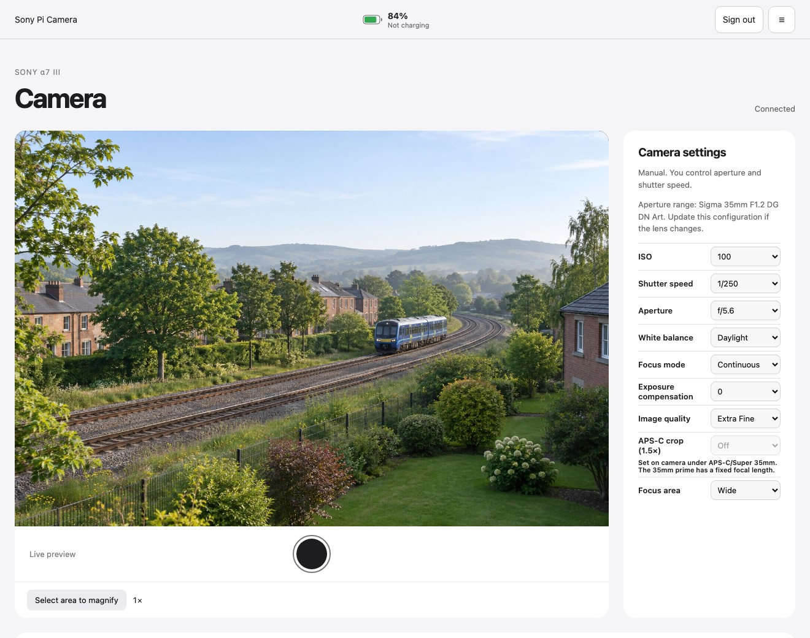
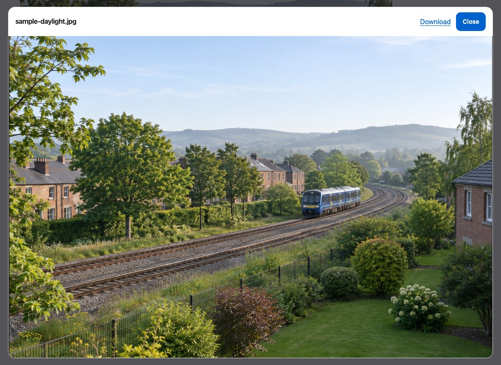
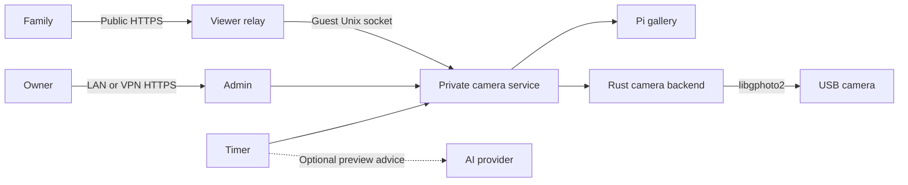

# Sony Pi Camera

Preview, control, and schedule photos from a USB-connected Sony camera on a Raspberry Pi. A family password or invitation opens a read-only gallery with live preview and original downloads. Optional AI advice suggests settings before a scheduled shot.

Screenshots use a synthetic camera scene and sample settings.

[Setup and operation](SETUP.md) · [USB benchmarks](SETUP.md#compare-usb-preview-backends) · [Changelog](CHANGELOG.md) · [Glossary](GLOSSARY.md) · [MIT license](LICENSE)
