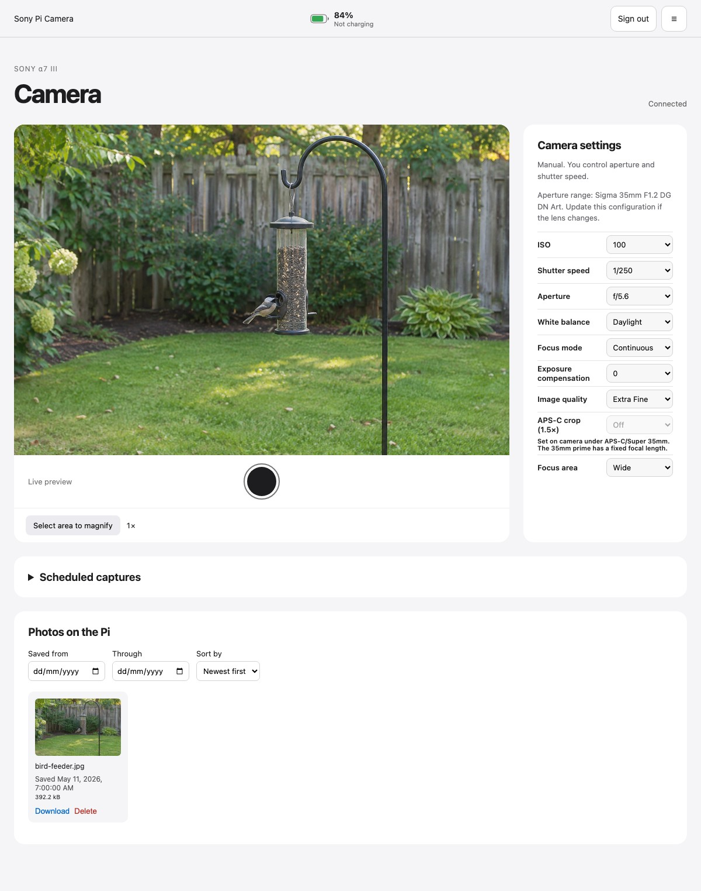
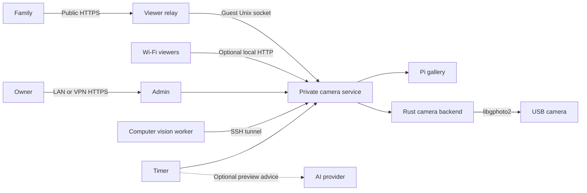

# Sony Pi Camera

Turn your high-end camera into a private monitoring system. The Raspberry Pi controls the camera over USB, serves a live preview, and saves full-resolution stills. Run computer vision on a separate Mac or GPU machine of your choice.

Start with the tested Sony α7 III and Raspberry Pi Zero 2 W. [Build the first setup](SETUP.md#first-monitoring-setup)

The admin takes a photo from the live preview. It appears below under **Photos on the Pi**.

Family members can open that same photo in their read-only viewer and download the original.

Example setup for watching a backyard bird feeder and sharing photos with family. The scene and settings are simulated.

## Why use this?

Keep the lens and image quality of a dedicated camera while a Raspberry Pi handles capture, storage, and remote access.

- **Make a timelapse.** Schedule photos of a growing plant, a backyard feeder, or a workshop project. Assemble the saved frames into a video.
- **Get AI advice before a shot.** Ask a vision model to inspect a preview and suggest settings for a goal like keeping birds sharp in changing light. [Set up AI advice](SETUP.md#optional-ai-advice-before-capture)
- **Capture an event.** Run a detector on a separate machine, watch a bird feeder through the USB preview, and ask the Pi to take a full-resolution still when a bird lands. [Connect a computer vision worker](SETUP.md#connect-a-computer-vision-worker)

## Architecture

The Raspberry Pi controls the Sony camera over USB and stores the photos locally. The owner uses the browser dashboard to adjust settings or take a photo. Family viewers reach the live preview and gallery through a read-only HTTPS relay.

The admin can see who is watching the live preview, including Wi-Fi streams, with an approximate country map for public viewers.

Scheduled captures run on the Pi even when the separate compute machine is offline. When AI advice is enabled, the timer can send a preview to a vision model before taking the photo.

[Setup and operation](SETUP.md) · [Changelog](CHANGELOG.md) · [Glossary](GLOSSARY.md) · [MIT license](LICENSE)
