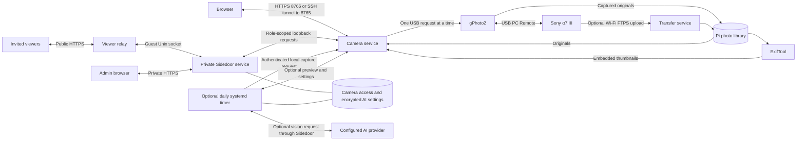

# Sony Pi Camera

Control a USB-connected Sony α7 III from a browser on your local network. A Raspberry Pi serves the live preview, camera controls and photo gallery. This setup has been tested with an α7 III running firmware 4.04, a Sigma 35mm F1.2 DG DN Art and a Raspberry Pi Zero 2 W.

## Why this exists

A camera mounted out of reach can be awkward to operate from its rear screen. A Pi beside the camera keeps the USB connection open so a photographer on the same Wi-Fi can check focus, trigger the shutter and review original files from a browser.

## Connect the camera

Power the Pi separately. Connect the camera to the Pi's USB data port using a data cable and, on a Zero, an OTG adapter. Set the camera's USB Connection to **PC Remote**. On the Pi, sign in as the account that will operate the camera and run the following commands.

```sh
sudo apt update
sudo apt install git cargo libgphoto2-dev libimage-exiftool-perl openssl python3-pil
git clone https://github.com/affromero/sony-pi-camera.git
cd sony-pi-camera
cargo build --locked --release --manifest-path camera/rust-preview/Cargo.toml
sudo sh camera/install.sh
```

The installer starts a systemd service under your account. To view its status or troubleshoot a busy USB device, use these commands. Close other software holding the camera before restarting the service.

```sh
systemctl status "sony-pi-camera@$USER"
journalctl -u "sony-pi-camera@$USER" -n 30
```

## First monitoring setup

- **Camera.** Sony α7 III, your lens, a stable mount, and a power supply suitable for the planned run time.
- **Pi.** Raspberry Pi Zero 2 W, microSD card, and separate Pi power.
- **USB.** A data cable and an OTG adapter for the Pi Zero's data port. Leave room for the plugs and secure the cable to the mount so a tug does not pull on the camera or Pi connector.

Put the camera somewhere dry with an unobstructed view. Connect it in [PC Remote mode](#connect-the-camera), [open the dashboard](#open-the-dashboard), and take one photo. Open it under **Photos on the Pi** to confirm that capture and storage work.

A printable Pi case is planned. The first design should leave the data, power, and microSD ports accessible and provide cable strain relief. [Pi Zero 2 W mechanical drawing](https://pip.raspberrypi.com/categories/584)

HDMI capture is pending hardware testing. This setup uses USB preview and still capture.

## Connect a computer vision worker

Run the detector on your own computer. The Pi supplies preview JPEGs and saves the original still when the worker requests a capture. Keep the camera API private and open an SSH tunnel from the worker to the Pi.

```sh
ssh -o ExitOnForwardFailure=yes -N -L 127.0.0.1:8765:127.0.0.1:8765 user@hostname.local
```

In a second terminal on the worker, run this Python 3 example to download one preview. Change the opening command to `python3 - --capture <<'PY'` to also request one still. Enter the camera access key at the prompt.

```sh
python3 - <<'PY'
import getpass
import json
import sys
from pathlib import Path
from urllib.request import Request, urlopen

base = "http://127.0.0.1:8765"
headers = {"X-Camera-Token": getpass.getpass("Camera access key: ")}

with urlopen(Request(base + "/api/preview", headers=headers), timeout=30) as response:
    Path("preview.jpg").write_bytes(response.read())

if "--capture" in sys.argv:
    request = Request(
        base + "/api/capture",
        data=b"{}",
        headers={**headers, "Origin": base, "Content-Type": "application/json"},
    )
    with urlopen(request, timeout=120) as response:
        print(json.load(response)["files"])
PY
```

For a bird feeder, pass each preview to a detector on the worker, then request a still when a bird first enters the area you care about. Start with a low polling rate and add a cooldown between captures. If the camera returns HTTP 409, it is busy with another operation. Back off before polling again. Leave the camera in full-frame view and select a JPEG capture setting for the first test. The capture response lists the files saved on the Pi.

## Open the dashboard

**On the Mac**, use Terminal to clone a second copy of the project. Replace `user@hostname.local` with the Pi account and hostname you configured. The first SSH command should print the Pi's hostname using your SSH key.

```sh
git clone https://github.com/affromero/sony-pi-camera.git
cd sony-pi-camera
ssh -o BatchMode=yes user@hostname.local hostname
sh camera/open-camera.sh user@hostname.local
```

The helper opens the authenticated dashboard in your browser. With the camera on and connected in PC Remote mode, look for **Connected** and a live image. You can reopen `http://localhost:8765/` in the same browser tab while the tunnel is running.

On a phone or another device on the same LAN, use `https://hostname.local:8766/` with your Pi's actual hostname. Retrieve the public certificate and access key over SSH. Compare the downloaded certificate's SHA-256 fingerprint with the Pi's output before trusting it on your device. Enter the access key on the dashboard. Keep the service on your local network.

```sh
ssh user@hostname.local 'openssl x509 -in ~/.config/sony-pi-camera/camera.crt -noout -fingerprint -sha256'
scp user@hostname.local:.config/sony-pi-camera/camera.crt ./camera.crt
openssl x509 -in camera.crt -noout -fingerprint -sha256
ssh user@hostname.local 'cat ~/.config/sony-pi-camera/camera-token'
```

On iPhone or iPad, transfer the verified public certificate to the device and install its profile. In **Settings → General → About → Certificate Trust Settings**, enable trust for that certificate, then open the Pi's HTTPS address in Safari. [Apple’s certificate trust instructions](https://support.apple.com/en-us/102390)

## USB preview

Rust 1.85 or newer is required to build the backend. Rust handles every USB
operation through libgphoto2. Preview reuses a USB session and releases it
after five idle seconds or before settings, focus or capture opens its own
session. Use the service journal to inspect USB errors.

The live viewer streams Rust camera JPEGs by default. Up to three viewers
share one capture loop, which starts at most ten captures per second. Disable
response buffering on the proxy. The camera controls read the magnification
and framing data with each preview.

## Shooting and reviewing photos

The live view requests one JPEG at a time over USB. When you focus, change a setting, move the magnifier or take a photo, the dashboard holds the last frame and pauses the camera controls. Live view resumes when the operation finishes. Another browser attempting a camera command at the same time receives a busy message.

- Set the lens to AF and the camera's focus area to Flexible Spot. Tap the live preview to move the focus point and autofocus. A green marker indicates the body reported a lock.
- Choose **Select area to magnify** below the live preview, then drag a box around the detail you want to inspect. On a phone you can also tap its center. The camera uses its supported magnification steps. The orange outline on the overview shows the area it actually displays. Choose **Full frame** to select another area or tap to focus.
- The dashboard polls the battery level, shooting mode and settings. APS-C crop is adjustable on the body and displayed in the browser. Aperture choices currently assume the tested Sigma lens.
- Press the shutter in a magnified view to save that framing as a JPEG in the Pi gallery. The Pi crops the camera's full-resolution JPEG at its native pixel size, so a tighter crop has fewer pixels. Choose a JPEG or RAW + JPEG capture setting for framed shots. At **Full frame**, the shutter downloads the camera files directly.
- Existing SD card folders are unavailable over this body's PC Remote connection. The gallery also picks up photos transferred into the same directory.

## Share the live camera

The optional Sidedoor viewer has its own hostname and access rules. Use the admin password to view and download photos, change camera settings, delete Pi copies, configure AI advice, and issue viewer invitations. Each invitation works once within 24 hours. The viewer can see the live preview and download the entire Pi gallery, including future captures and uploads. A viewer session lasts 30 days on the browser that accepted it. Use **Show active viewers** to revoke one early. The private Pi dashboard and other projects keep their own access.

Install Node.js 22 or newer on the Pi, with `node` on systemd's PATH. On a Linux ARM64 builder, run `npm ci --prefix camera/sidedoor` and `npm run build --prefix camera/sidedoor`. Include the generated `web/admin-qr.js`, `web/passkey-client.js`, and Linux ARM64 runtime dependencies in the deployment bundle. Run the camera installer, place those runtime dependencies in `/opt/pi-camera/sidedoor/node_modules`, and create the admin in a Bash shell on the Pi. Use a strong, unique password.

```sh
viewer_state="/var/lib/sony-pi-camera-$USER"
sudo install -d -m 700 -o "$USER" "$viewer_state"
read -r -s -p 'Camera admin password: ' viewer_password
printf '\n'
printf '%s\n' "$viewer_password" | STATE_DIRECTORY="$viewer_state" \
  node /opt/pi-camera/sidedoor/web/server.mjs setup
unset viewer_password
```

Replace `camera.example.com` with the viewer's HTTPS hostname.

```sh
printf '%s\n' 'ADMIN_ORIGIN=https://camera-admin.example.com' \
  'VIEWER_ORIGIN=https://camera.example.com' | \
  sudo tee "/etc/sony-pi-viewer-$USER.conf" >/dev/null
sudo chmod 600 "/etc/sony-pi-viewer-$USER.conf"
sudo systemctl enable --now "sony-pi-viewer@$USER.service" "sony-pi-public-viewer@$USER.service"
```

Route the public hostname to `unix:/run/sony-camera-public-$USER/viewer.sock` on the Pi. Set `ADMIN_ORIGIN` and `VIEWER_ORIGIN` to that same HTTPS origin to offer admin password login and viewer invitations on one page. The admin password unlocks controls and AI settings. Invited viewers can open the preview and gallery.

For a separate private admin hostname, set distinct origins and route the admin hostname over LAN or VPN to `/run/sony-camera-$USER/admin.sock`. Preserve the Host header and bypass caching for either setup. The public connector needs access only to the public socket.

Sign in as admin and create a link under **Viewer invitations**. Share the link or its QR code with one recipient. The QR code under **Camera access** opens the admin login page and still requires the password.

After admin sign-in, the shared site opens the same camera controls used on the Pi. Use the menu at the top right to manage invitations and AI advice.

Under **Viewer invitations**, choose **Disconnect all viewers** to sign out current family and invitation sessions and stop their live previews. Family members can sign in again with their password, and unused invitations still work. Your preview pauses while the administration menu is open.

The viewer stops streaming when its tab is hidden or after 15 seconds without input. Returning to the tab, moving the pointer, tapping, or pressing a key wakes the preview. Change the timeout under **Preview sleep** in the admin menu. Other viewers pick up the new timeout the next time they open the viewer.

Choose **Sleep preview** to stop streaming in this tab immediately. It stays asleep until you choose **Resume preview**, even if you move the pointer or switch tabs. Other viewers can keep watching.

The rear LCD is controlled on the camera. Enable **Monitor Off** under **Camera Settings2 → DISP Button → Monitor**, then use the camera's DISP button to switch display modes. The α7 III can suspend automatic power save while connected to a computer. [Sony finder and monitor settings](https://helpguide.sony.net/ilc/1720/v1/en/contents/TP0001629732.html) · [Sony power-save guide](https://helpguide.sony.net/ilc/1720/v1/en/contents/TP0001653176.html)

To add a reusable family password, run the viewer's `setup-family` command with the same state directory as the admin setup and supply a separate password on stdin. Restart the viewer afterward. On the shared hostname, enter either password and select **Sign in**. The family password opens the live preview and gallery.

New admin and family sign-ins stay signed in on the same browser for 30 days. Signing out ends the session immediately. The cookie contains a session token.

### Password-free viewer on local Wi-Fi

In the viewer's existing `/etc/sony-pi-viewer-USER.conf`, set `LAN_VIEWER_CIDR` to the Pi's Wi-Fi address and prefix from `ip -4 -br addr show wlan0`. Set `LAN_VIEWER_ORIGIN` to the local URL, using that address or the Pi's local hostname. For example:

```ini
LAN_VIEWER_CIDR=192.168.4.111/22
LAN_VIEWER_ORIGIN=http://192.168.4.111
```

For a friendly name, set `LAN_VIEWER_ORIGIN=http://livecamera.local`. The installer provides a service that advertises the name through Avahi without replacing the Pi's own hostname. Install the Avahi tools and enable the service on the Pi under the account that runs the camera.

```sh
sudo apt install avahi-utils
sudo systemctl enable --now "sony-pi-lan-name@$USER.service"
sudo systemctl restart "sony-pi-viewer@$USER.service"
```

Open the configured URL from the same IPv4 subnet. The listener also accepts its own IPv4 address at the same port.

Anyone on that subnet can see the live preview and saved photos. The local listener carries media over HTTP. Keep this port off public tunnels, reverse proxies and router port forwards. Wi-Fi client isolation can block access even on the same network. Reserve the Pi's IP in DHCP. If it changes, update the configuration and restart the viewer. The public HTTPS viewer keeps its existing sign-in rules.

After signing in with the admin or family password, choose **Save a passkey** to use Touch ID, Face ID, or your device PIN on later visits. Choose **Sign in with a passkey** on the same HTTPS hostname to return in the role you enrolled. Invitation links continue to grant read-only sessions. Keep your password for browsers or devices without your saved passkey.


## Daily photos

The installer provides an optional systemd timer. It starts disabled and defaults to 08:00 in the Pi's timezone. Leave the camera powered on in PC Remote mode. Each run saves a photo in the dashboard gallery using the camera's current settings and framing, including any active magnifier crop.

In the private camera dashboard, open **Scheduled captures**. Choose a
time and zone, add more times if needed, then select **Enable daily
captures** and **Save schedule**. Clear the checkbox and save to pause.
Check the next run on the Pi with:

```sh
systemctl list-timers --all "sony-pi-capture@$USER.timer"
```

The timer skips missed times while the Pi is off. If another camera command is running, the job waits up to one minute for its turn. To take one photo immediately, run `sudo systemctl start "sony-pi-capture@$USER.service"`. Check filenames or errors with `journalctl -u "sony-pi-capture@$USER.service" -n 10`. To stop future shots, run `sudo systemctl disable --now "sony-pi-capture@$USER.timer"`.

### Optional AI advice before capture

The timer can send one JPEG preview and the camera's current exposure and white balance settings to a vision model through Sidedoor. Give it a goal such as “Keep moving subjects sharp and lift dark shadows.” The job logs an assessment and any suggested values the camera reports as writable. Suggestions appear in the systemd journal, and the shutter uses the camera's current settings. Camera controls are available again while the model runs, so a manual change can affect the subsequent shot.

Sign in as admin and open **AI advice for scheduled captures**. Choose an API provider, enter a vision model with structured output, add its API key and describe the photo you want. Select **Analyze a preview before each scheduled shot** and save. Sidedoor encrypts the API key on the Pi. A blank key field keeps the selected provider's saved credential. **Check saved API key** contacts that provider without sending a camera preview.

If advice fails, the timer logs the error and takes the photo. Select **Require AI advice before capture** to skip the shot when advice fails.

## Optional camera uploads over Wi-Fi

The optional explicit FTPS receiver accepts the configured camera's IPv4 address and writes uploads to the gallery. It permits legacy TLS for older Sony firmware. Use it only on a trusted LAN. Reserve the Pi and camera addresses in DHCP.

Install the receiver dependencies and replace `CAMERA_IPV4` below with the camera's address.

```sh
sudo apt install python3-pyftpdlib python3-openssl
printf '%s\n' CAMERA_IPV4 > ~/.config/sony-pi-camera/transfer-camera-ip
sudo systemctl enable --now "pi-camera-transfer@$USER"
```

Copy the Pi's public `~/.config/sony-pi-camera/transfer-ca.crt` to an SD card as `cacert.pem`. Use slot 1 and select **Network → Import Root Certificate** on the Sony. For the FTP destination, enter the Pi's IPv4 address, port 2121, user `camera`, and the password stored on the Pi in `~/.config/sony-pi-camera/transfer-password`. Enable Secure Protocol, passive transfer and certificate verification. Allow inbound TCP 2121 and 30000 through 30010 from the camera if a LAN firewall is active. Concurrent FTP and USB remote operation depends on camera configuration.

## Architecture



The Pi can serve its library while the camera is disconnected. Capturing and live preview require the USB connection. See the [camera glossary](GLOSSARY.md) for the names used in the interface.

## Development

On your development machine, install Git, uv, Node.js 22.13+ (22.x) or 24+, npm, ShellCheck, and Rust with Cargo. The setup script installs the locked Python and JavaScript dependencies and registers the Git hooks. It also installs rustfmt and Clippy if Rust is managed by rustup.

```sh
./scripts/setup.sh
uv run --frozen pre-commit run --all-files
uv run --frozen python -m unittest discover -s tests -v
npm test --prefix camera/sidedoor
```

The dashboard uses Pillow for cropped JPEGs and `exiftool` for thumbnails. The Pi installer runs services under the OS Python. For local receiver development, `uv sync --frozen --extra ftps` installs pyftpdlib and pyOpenSSL. Update dependencies in `pyproject.toml`, run `uv lock` and commit the updated lockfile.

The tests start the HTTP service on loopback, use a temporary photo library and simulate the USB device. CI checks the lockfile, imports the optional FTPS receiver and runs the tests on Python 3.11 and 3.13. Test changes to capture, focus or magnification on a connected body before reporting hardware support.

The archived Windows utility SonyAlphaUSB provided a reference for the α7 III focus-point coordinates. [gPhoto2](https://github.com/gphoto/gphoto2) · [SonyAlphaUSB](https://github.com/pixeltris/SonyAlphaUSB)

## License

[MIT License](LICENSE) © 2026 Andrés Romero.
